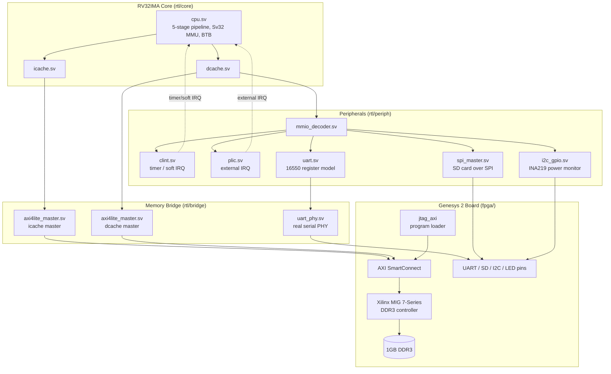

# Genesys 2 RISC-V SoC

A custom RV32IMA RISC-V system-on-chip, written from scratch in SystemVerilog,
targeting the Digilent Genesys 2 FPGA board (Xilinx Kintex-7 XC7K325T). The
core boots OpenSBI and a Linux kernel to an interactive console over a
self-built UART PHY, backed by 1GB of real DDR3 through Xilinx's MIG
controller.

## Highlights

- **Custom 5-stage pipelined RV32IMA core** (`rtl/core/cpu.sv`) — IF/ID/EX/MEM/WB,
  EX-EX and MEM-EX forwarding, 1-cycle load-use stall, a 64-entry branch
  target buffer with 2-bit saturating counters, and hardware multiply/divide
  (M) and atomic memory operations (A).
- **Sv32 virtual memory** — a hardware page-table walker and ITLB/DTLB, enough
  to run an unmodified Linux kernel.
- **Instruction and data caches** (`icache.sv`, `dcache.sv`) bridged to DDR3
  over AXI4-Lite, with MMIO ranges decoded around the cache so peripheral
  accesses are never cached.
- **From-scratch UART PHY** (`rtl/bridge/uart_phy.sv`) — the Genesys 2 has no
  hard UART IP, so this project implements its own baud generator, TX
  serializer, and 16x-oversampled RX deserializer with FIFOs, behind a
  16550-compatible register model Linux's stock 8250 driver talks to
  natively.
- **SD card over SPI and onboard power monitoring** — a custom SPI master for
  microSD access and a bit-banged I2C/GPIO peripheral for the board's INA219
  power monitors.
- **Verified in both simulation and on real hardware** — a Verilator
  regression suite covering the core, caches, MMU, interrupts, and
  peripherals, plus staged Vivado bring-up bitstreams validated incrementally
  on the physical board.

## Architecture



Programs are loaded into DDR3 over JTAG (via the `jtag_axi` IP) before the
CPU is released from reset — the Genesys 2 has no hard processor system, so
this is the only path onto the board. Once released, the core fetches from
`0x8000_0000` and runs OpenSBI, which hands off to the Linux kernel.

### Memory map

| Region | Base address | Notes |
|---|---|---|
| RAM (DDR3 via MIG) | `0x8000_0000` | 1GB, cached |
| CLINT | `0x0200_0000` | timer/software interrupts |
| PLIC | `0x0C00_0000` | external interrupts |
| UART | `0x1000_0000` | 16550-compatible |
| SPI (SD card) | `0x1000_2000` | |
| I2C (power monitor) | `0x1000_3000` | |
| LED/GPIO | `0xFFFF_FFF0` | intercepted before the cache |

## Repository layout

```
rtl/core/     Custom RV32IMA pipeline, ALU, mul/div units, caches, regfile
rtl/periph/   CLINT, PLIC, UART register model, SPI master, I2C/GPIO
rtl/bridge/   AXI4-Lite master, UART PHY
fpga/         Genesys 2 board tops, XDC constraints, Vivado build/program scripts
sim/          Verilator testbench + per-feature regression suites
sw/           Bare-metal test firmware (blink, UART, SD, DDR, MMU repros)
opensbi/      Vendored OpenSBI firmware (PLATFORM=generic)
opensbi-patches/  Project-specific OpenSBI patches
linux-patches/    Kernel config baselines and the board device tree
```

## Building and simulating

Prerequisites: [Verilator](https://www.veripool.org/verilator/), a
`riscv64-unknown-elf-` GCC toolchain, `dtc`, and (for FPGA builds) Xilinx
Vivado.

```sh
make compile          # build the Verilator simulation model
make run-tests         # directed regression suite
make run-riscv-tests    # official riscv-tests ISA compliance suite
make run-opensbi        # boot OpenSBI + a test payload in simulation
```

Peripheral-specific regressions (`run-uart-tests`, `run-spi-master-test`,
`run-clint-tests`, `run-plic-tests`, `run-mmu-tests`, `run-priv-tests`,
`run-axi-bridge-test`, `run-sd-tests`, …) are also available — see the
`Makefile` for the full list.

### FPGA bring-up

The board is brought up in stages, each a separate top-level module and
Vivado script pair under `fpga/`, isolating one new piece of risk at a time:

1. `genesys2_blink` — clock, LED, and JTAG smoke test (no core RTL)
2. `genesys2_top_min` — the CPU + on-chip LUTRAM, no DDR3 or real UART pins
3. `genesys2_top_uart` — adds the real UART PHY
4. `genesys2_top_ddr` — adds DDR3 via MIG, the full Linux-capable design
5. `genesys2_top_sd` — adds SD-over-SPI and I2C power monitoring

Each stage has matching `build_<stage>.tcl` / `program_<stage>.tcl` scripts,
run via `vivado -mode batch -source fpga/build_<stage>.tcl`.
